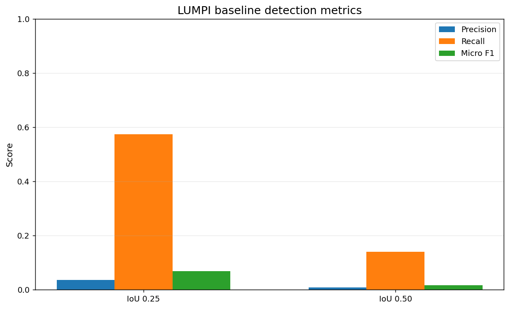
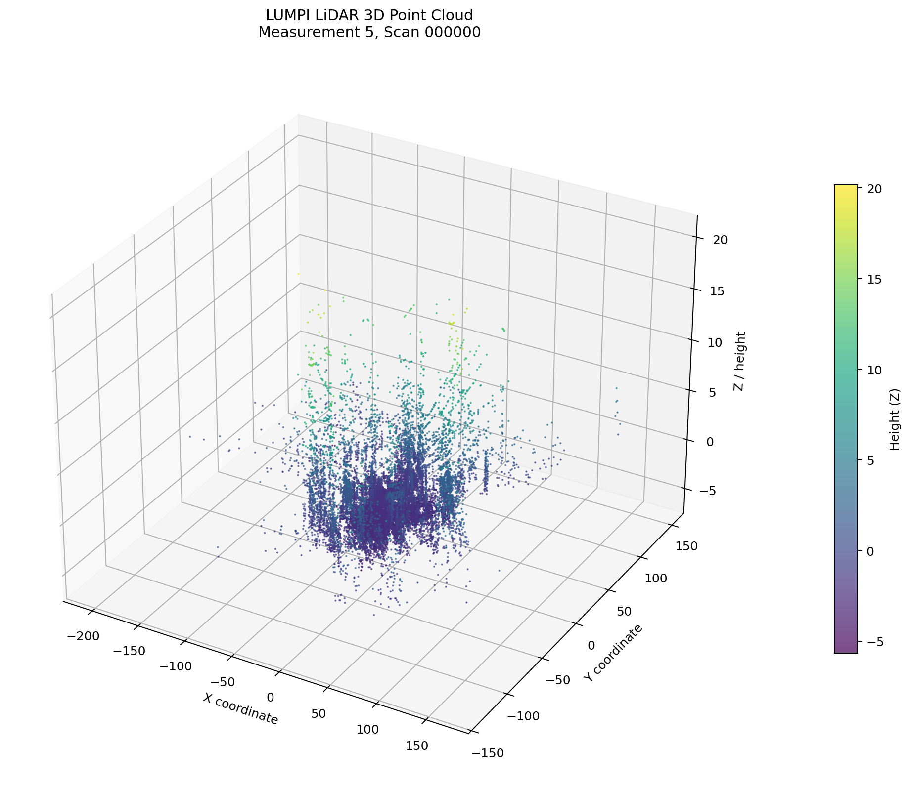
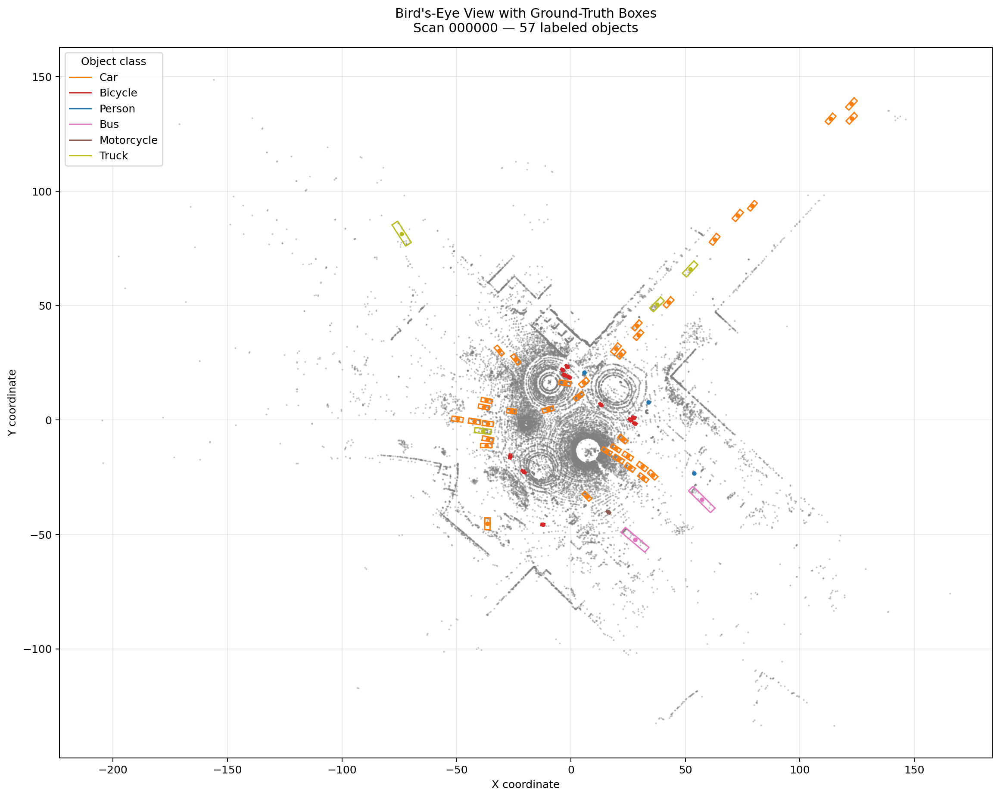
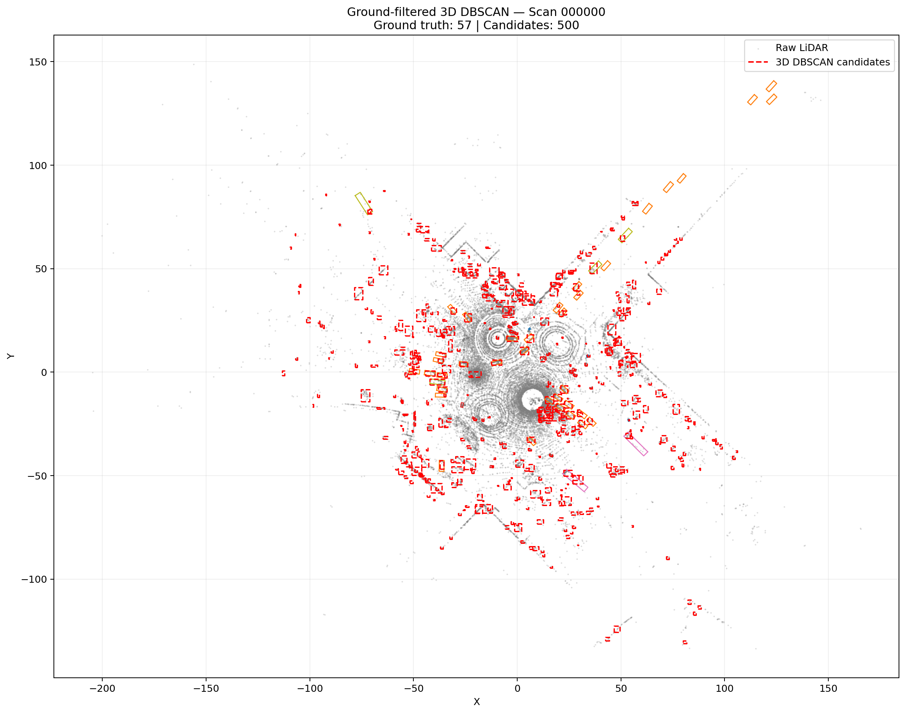
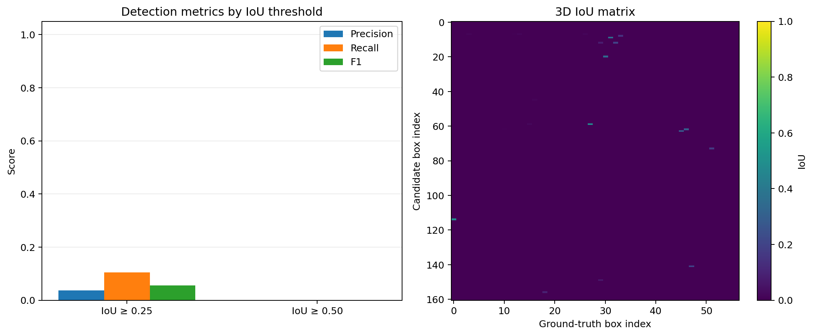
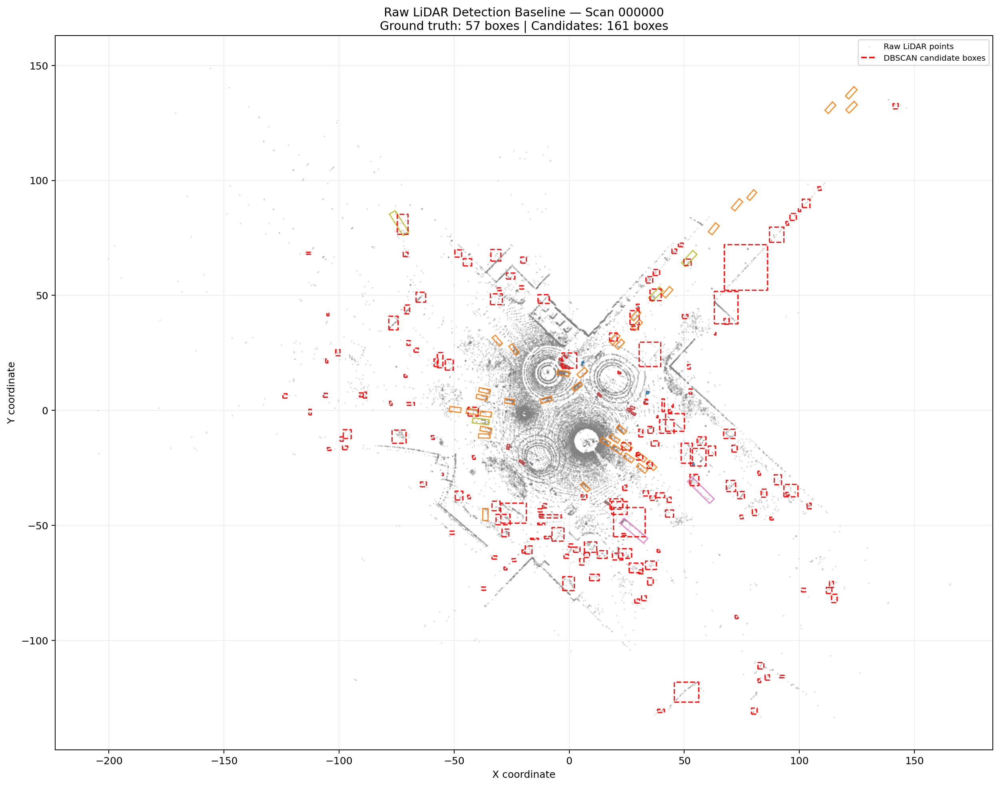
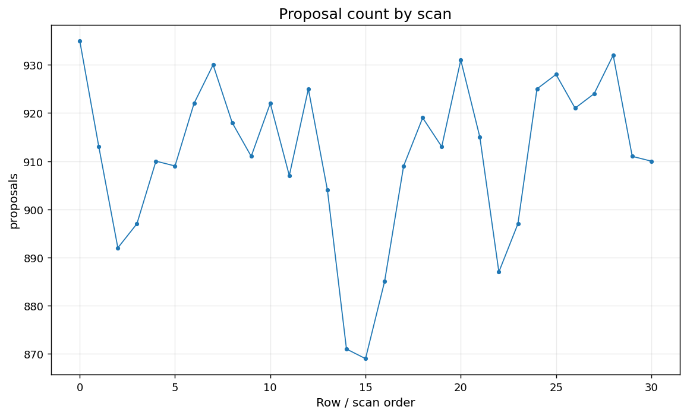
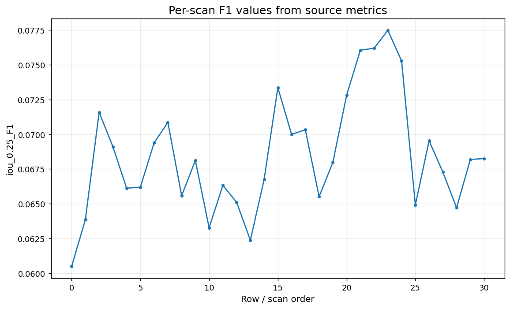
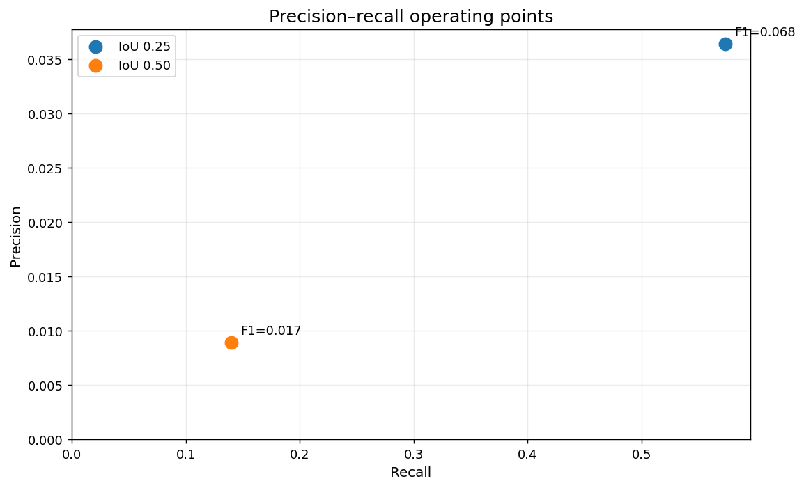
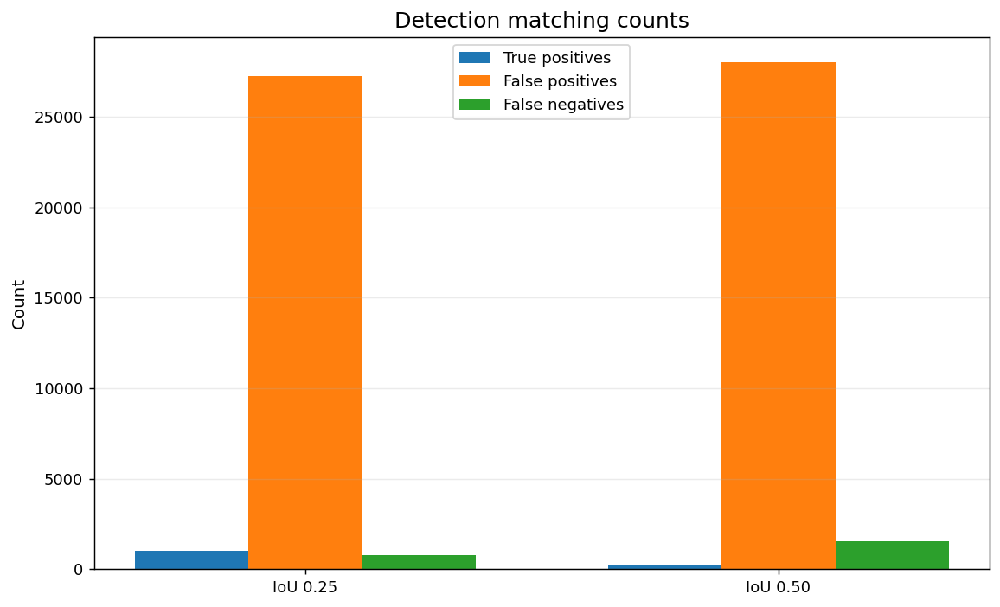

# LUMPI — LiDAR Object Detection Research Prototype

<p align="center">
  
  
  
  
</p>

<p align="center">
  <strong>Geometry-driven 3D perception. Reproducible experiments. Honest evaluation.</strong>
</p>

<p align="center">
  <a href="https://github.com/ut1776/lumpi-lidar-detection">Repository</a> ·
  <a href="https://github.com/ut1776/lumpi-lidar-detection/tree/main/Video%20clip">LiDAR Video Demo</a> ·
  <a href="https://github.com/ut1776/lumpi-lidar-detection/tree/main/figures">Research Figures</a>
</p>

---

## Overview

**LUMPI** is an independent research prototype exploring three-dimensional LiDAR object detection using classical point-cloud processing techniques.

The project combines height filtering, voxel-grid downsampling, density-based spatial clustering of applications with noise (DBSCAN), cluster-derived bounding boxes, and preliminary 3D detection evaluation.

Its purpose is to establish a transparent baseline, investigate object-localization errors, and develop a scientifically defensible foundation for future improvements in geometric perception.

Rather than claiming state-of-the-art performance, LUMPI documents both its experimental results and the limitations that must be resolved before those results can support stronger conclusions.

## 🎬 LiDAR Visualization

Explore the animated vehicle and LiDAR simulation, including the driving scene, bird's-eye view, 3D point cloud, and rotating azimuth scan.

<p align="center">
  <a href="https://github.com/ut1776/lumpi-lidar-detection/blob/main/Video%20clip/LiDAR.mp4">
    
  </a>
</p>

**Video file:** [`Video clip/LiDAR.mp4`](Video%20clip/LiDAR.mp4)

The animation illustrates the visualization pipeline and synthetic point-cloud behavior. It is a simulation, not a recording from a real vehicle-mounted LiDAR sensor.

---

## Research Highlights

* **Classical 3D perception:** A baseline built from established geometric processing techniques.
* **Point-cloud processing:** Height filtering and voxel-grid downsampling.
* **Density-based grouping:** DBSCAN clustering to generate candidate object regions.
* **3D localization:** Bounding boxes derived from cluster geometry.
* **Quantitative evaluation:** Preliminary precision, recall, F1, and intersection-over-union (IoU) measurements.
* **Visual diagnostics:** Point clouds, bird's-eye views, proposal counts, detection errors, and prediction-versus-ground-truth comparisons.
* **Scientific transparency:** Explicit documentation of uncertain annotation semantics, temporal alignment, coordinate conventions, and evaluation methodology.

## 📊 Preliminary Experimental Results

The initial experiment processed **31 scans from the Measurement5 subset**, generating 28,242 candidate proposals and evaluating 1,792 provisionally selected ground-truth boxes.

| Metric               | IoU ≥ 0.25 | IoU ≥ 0.50 |
| -------------------- | ---------: | ---------: |
| True positives (TP)  |      1,028 |        251 |
| False positives (FP) |     27,214 |     27,991 |
| False negatives (FN) |        764 |      1,541 |
| Micro-precision      |      3.64% |      0.89% |
| Recall               |     57.37% |     14.01% |
| Micro-F1             |     0.0685 |     0.0167 |

### What do these results tell us?

At the more permissive IoU threshold of 0.25, the prototype matches a substantial fraction of the provisionally selected annotations. However, its precision is low because many generated proposals remain unmatched.

At IoU 0.50, the number of successful matches falls substantially. This indicates that localization accuracy, cluster quality, candidate filtering, or evaluation assumptions require further investigation.

These measurements establish an initial diagnostic baseline—not a competitive detection result.

> **Evaluation disclaimer:** The annotation filter, scan-to-label temporal association, coordinate conventions, and axis-aligned 3D overlap calculation have not been independently verified against the dataset's authoritative specification. The reported metrics are preliminary internal measurements, not official benchmark scores.

## 🔬 Detection Pipeline

The baseline follows six principal stages:

```text
LiDAR Point Cloud
        │
        ▼
Height Filtering
        │
        ▼
Voxel-Grid Downsampling
        │
        ▼
DBSCAN Clustering
        │
        ▼
Cluster-Derived 3D Bounding Boxes
        │
        ▼
IoU Matching and Diagnostic Evaluation
        │
        ▼
Precision · Recall · F1 · Error Analysis
```

### 1. Height filtering

Points below a configured height threshold are removed to reduce unwanted geometric structures.

### 2. Voxel downsampling

A voxel grid reduces point-cloud density and the computational load of subsequent clustering.

### 3. DBSCAN clustering

Spatially dense regions are grouped into clusters, with insufficiently dense points potentially classified as noise.

### 4. Candidate bounding boxes

The spatial extents of retained clusters are used to generate candidate boxes. These regions are not guaranteed to correspond one-to-one with physical objects.

### 5. IoU-based matching

Candidate boxes are compared with ground-truth annotations using preliminary axis-aligned 3D intersection-over-union calculations.

### 6. Evaluation and diagnostics

True positives, false positives, false negatives, precision, recall, F1, and per-scan behavior are examined to identify failure modes.

## ⚙️ Experimental Configuration

| Parameter                      | Initial setting              |
| ------------------------------ | ---------------------------- |
| Dataset subset                 | Measurement5                 |
| Processed scans                | 31                           |
| Provisional ground-truth boxes | 1,792                        |
| Candidate proposals            | 28,242                       |
| Height threshold               | -1.8                         |
| Voxel size                     | 0.12                         |
| DBSCAN epsilon                 | 0.65                         |
| DBSCAN minimum samples         | 6                            |
| Provisional annotation filter  | `score == 4`                 |
| Timestamp mapping              | Scan index / 10              |
| IoU thresholds                 | 0.25 and 0.50                |
| Matching procedure             | Greedy one-to-one            |
| Box overlap geometry           | Approximate, axis-aligned 3D |

Parameter values are recorded experimental settings, not proven optima. Their interpretation depends on the dataset's coordinate system, units, annotation schema, and timestamp conventions.

## 🖼️ Research Figures and Visual Diagnostics

The [`figures/`](figures/) directory contains the visual diagnostics associated with the research paper.

### Aggregate detection metrics



Examines the relationship between overlap thresholds and detection performance.

### 3D point-cloud visualization



Supports inspection of point distributions and coordinate structure.

### Bird's-eye view and ground truth



Helps investigate the spatial relationship between LiDAR points and annotations.

### DBSCAN clusters versus ground truth



Supports investigation of cluster fragmentation, merging, and background inclusion.

### Detection evaluation



Visualizes the candidate detection evaluation.

### Predictions versus ground truth



Helps inspect bounding-box localization and geometric overlap.

### Proposal counts by scan



Shows how candidate generation varies across the evaluated scans.

### Per-scan F1



Provides a view of scan-level variation in the reported F1 measurements.

### Precision-recall diagnostic



Provides a diagnostic view of precision and recall. A complete precision-recall curve requires a documented sweep over an appropriate confidence or decision threshold.

### Detection error counts



Supports investigation of false-positive and false-negative behavior.

**Figure integrity:** These figures are intended as diagnostics. Their plotted values and interpretation should be checked against the underlying experimental data and plotting code.

## 📄 Research Paper

The accompanying research paper is titled:

**LUMPI: A LiDAR Object-Detection Research Prototype Using Height Filtering, Voxel Downsampling, and Density-Based Clustering**

It uses the IEEE conference paper format and documents the motivation, related work, dataset assumptions, methodology, experimental results, visual diagnostics, threats to validity, and recommended next steps.

The paper's main conclusion is that the baseline can generate candidate regions but requires substantial improvements in precision, localization, and evaluation validity.

To compile the paper, place `main.tex` at the repository root and ensure the referenced figure files exist in `figures/`. Compile using an IEEE-compatible LaTeX environment.

## 🚧 Current Limitations

The following issues must be addressed before stronger scientific or benchmark claims are justified.

* **Annotation semantics:** The meaning of the provisional `score == 4` filter and the annotation columns must be confirmed.
* **Temporal alignment:** Scan timestamps must be matched to the correct annotation frames using authoritative dataset metadata.
* **Coordinate conventions:** Axis order, coordinate units, box dimensions, center locations, and heading conventions require verification.
* **Oriented 3D IoU:** Axis-aligned overlap does not fully represent rotated three-dimensional objects.
* **Proposal quality:** The high false-positive count indicates a need for better candidate filtering and localization.
* **Evaluation matching:** Greedy matching should be checked against a trusted reference evaluator.
* **Dataset coverage:** Thirty-one scans are insufficient to establish generalization across scenes and conditions.
* **Research novelty:** Combining established filtering and clustering techniques does not, by itself, establish a new scientific contribution.

## 🧭 Research Roadmap

The next development phase prioritizes correctness before complexity.

* [ ] Verify annotation field definitions and ground-truth selection.
* [ ] Validate scan-to-label temporal alignment.
* [ ] Confirm coordinate frames, units, and bounding-box conventions.
* [ ] Test 3D IoU on synthetic boxes with known intersections.
* [ ] Implement and validate oriented 3D IoU.
* [ ] Audit one-to-one matching against a trusted evaluation implementation.
* [ ] Establish separate development and validation data.
* [ ] Run controlled sweeps over voxel size and DBSCAN parameters.
* [ ] Evaluate cluster-size and geometric proposal filters.
* [ ] Expand testing to additional scans and relevant object classes.
* [ ] Compare against established baselines under consistent evaluation rules.
* [ ] Conduct a literature and novelty review before making research novelty claims.

## 📚 References

1. M. Ester, H.-P. Kriegel, J. Sander, and X. Xu, “A Density-Based Algorithm for Discovering Clusters in Large Spatial Databases with Noise,” KDD, 1996. [Paper](https://file.biolab.si/papers/1996-DBSCAN-KDD.pdf)
2. A. Geiger, P. Lenz, and R. Urtasun, “Are We Ready for Autonomous Driving? The KITTI Vision Benchmark Suite,” CVPR, 2012. [DOI](https://doi.org/10.1109/CVPR.2012.6248074)
3. [KITTI 3D Object Detection Benchmark](https://www.cvlibs.net/datasets/kitti/eval_3dobject.php)
4. [Open3D Point Cloud Documentation](https://www.open3d.org/docs/release/tutorial/geometry/pointcloud.html)
5. A. H. Lang et al., “PointPillars: Fast Encoders for Object Detection from Point Clouds,” CVPR, 2019. [Paper](https://openaccess.thecvf.com/content_CVPR_2019/html/Lang_PointPillars_Fast_Encoders_for_Object_Detection_From_Point_Clouds_CVPR_2019_paper.html)

## 👤 Author

**Umar Tabbsum**
Independent Researcher

GitHub: [@ut1776](https://github.com/ut1776)

Project: [lumpi-lidar-detection](https://github.com/ut1776/lumpi-lidar-detection)

## 📜 Project Status

LUMPI is an experimental research prototype. Its purpose is to establish a transparent baseline, expose methodological uncertainties, and support reproducible investigation into geometric LiDAR perception.

No state-of-the-art performance, official benchmark result, or novel detection mechanism is claimed by the current experiment.

---

<p align="center">
  <strong>LUMPI — Building a stronger foundation for 3D perception, one experiment at a time.</strong>
</p>
